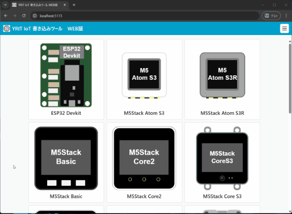
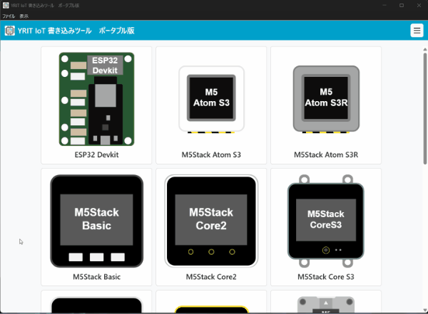

# YRIT IoT Burner（IoT ファームウェア書き込みアプリ）

<div align="center">
    
</div>

## 📖 概要

山形県工業技術センターが開発した IoT プラットフォームの IoT ファームウェア書き込みアプリです。  
IoT デバイスへのファームウェア書き込みを、Web Serial API を通じてブラウザから簡単に行うことができます。  
ネットワーク接続が必要な Web 版と、オフライン環境でも使用できる Electron 版の両方に対応しています。

✅ 多数のデバイスをサポート  
✅ 任意バージョンのファームウェアを選択可能

## 🎥 デモ

<div align="center">

|  |
| :-------------------------------------------------------------------: |
|                  🌐 Web 版（オンライン版）　デモ動画                  |

|  |
| :------------------------------------------------------------------------: |
|                  💻 Electron 版（オフライン版）　デモ動画                  |

</div>

### 🎮 ライブデモ 🎮

**Web版（オンライン版）のライブデモを [こちら](https://yrit-jp.github.io/yrit_iot_burner) から試すことができます。**

> [!NOTE]
> Web Serial API に対応したブラウザでのみ動作します。
>
> - Chrome / Edge 等

> [!TIP]
> Web Serial API の対応状況については各ブラウザの対応状況を確認してください。
>
> - [Web Serial API](https://developer.mozilla.org/ja/docs/Web/API/Web_Serial_API#%E3%83%96%E3%83%A9%E3%82%A6%E3%82%B6%E3%83%BC%E3%81%AE%E4%BA%92%E6%8F%9B%E6%80%A7)

## 📦 ダウンロード

Electron 版（オフライン版）は **[リリースページ](../../releases)** からダウンロードできます。

## 🚀 セットアップ

#### 🌐 Web 版（オンライン版）

このリポジトリをクローンし、依存関係の初期化とビルドを行ってください。  
詳しくは [開発者向けドキュメント](./DEVELOPMENT.md) を参照してください。

#### 💻 Electron 版（オフライン版）

ダウンロードした圧縮ファイルを解凍し、中にある `yrit_iot_burner` を起動します。  
アンインストールする場合はフォルダごと削除してください。

## ✨ ファームウェアの更新

書き込み可能なファームウェアは `firmware` フォルダで管理されており、`firmware` ブランチで管理されています。
デプロイ後のアプリケーションではそれぞれ下記のフォルダに存在しています。

- Web 版（オンライン版）
  - root 直下
- Electron 版（オフライン版）
  - resources フォルダ内

ファームウェアを更新（追加など）する場合は、ファームウェアを `firmware` フォルダ内に適切に配置し、`firmware.json` を更新する必要があります。`firmware` フォルダ内のディレクトリ構成は下記のようになっています。

```
firmware/
└── DEVICE_NAME/                      # サポートデバイス名
    └── FIRMWARE_NAME/                # ファームウェア名
        └── FIRMWARE_VERSION/         # ファームウェアバージョン
            └── FIRMWARE_BINARY_FILE  # ファームウェア本体
```

`firmware.json` は `generate_firmware_list_json.py` スクリプトを使用すると `firmware` フォルダの構成に合わせて自動的に生成することができます。

## 👨‍💻 開発者向け

開発環境のセットアップ、ビルド手順については [開発者向けドキュメント](./DEVELOPMENT.md) をご覧ください。

## 📜 ライセンス

本ソフトウェアはソースコード公開ソフトウェア（Source-Available Software）です。  
[YRIT Software License](./LICENSE) の下で公開されています。  
本ソフトウェアを利用する場合は、[ライセンスの条項](./LICENSE)に同意し、これに従う必要があります。

### ⚠️ 許可事項と制限事項 ⚠️

|         項目         | 可否 | 詳細                                               |
| :------------------: | :--: | -------------------------------------------------- |
|         使用         |  ✅  | 個人・法人問わず、プログラムを自由に使用できます   |
|         改変         |  ✅  | 個人・法人問わず、ソースコードを自由に改変できます |
|        再配布        |  ✅  | 個人・法人問わず、改変版を含め自由に再配布できます |
| 商用製品への組み込み |  🚫  | 製品・サービスへの組み込みは許可されません         |
|   ライセンスの変更   |  🚫  | 改変版も含め、ライセンスを変更することはできません |

詳細については [LICENSE](./LICENSE) ファイルをご確認ください。

### ❗ 重要事項 ❗

- **OSSではありません**: 本ソフトウェアは[オープンソースソフトウェア（OSS）](https://opensource.org/osd)ではありません
- **著作権表示の維持**: 再配布時は著作権表示とライセンス文を必ず含めてください
- **ライセンスの継承**: 改変版を配布する場合も、ライセンスを継承する必要があります
- **無保証**: 本ソフトウェアは現状のまま提供され、いかなる保証もありません

### 💼 商用利用について 💼

社内ツールとしての利用や、社内で閉じた業務での使用は問題ありません。  
ただし、本ソフトウェアを製品やサービスの一部として組み込んで提供・販売することは許可されていません。  
商用ライセンスが必要な場合は、お問い合わせください。

---

Copyright (C) 2025 Yamagata Research Institute of Technology  
Developed by takkaO
